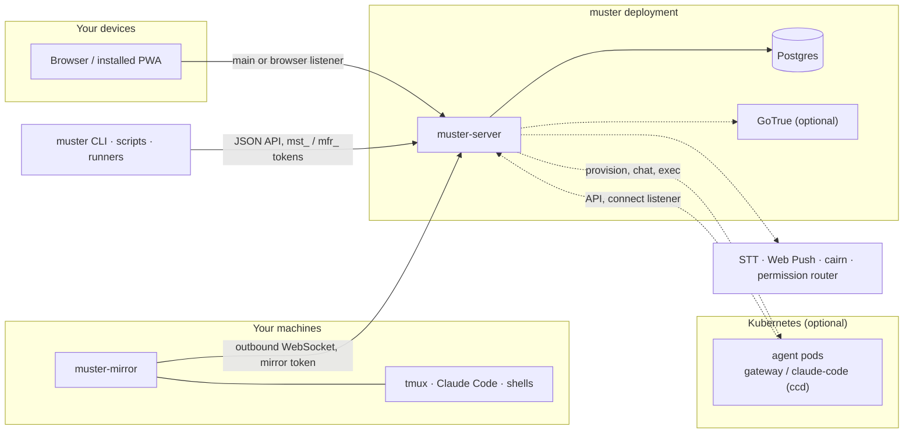

# Architecture

## Binaries

| binary | runs where | role |
|---|---|---|
| `muster-server` | your deployment | The HTTP API, the htmx UI, the mirror hub and the background loops. It migrates the database at boot. |
| `muster-migrate` | a deploy step or a dev machine | Applies the schema. It also holds the row-level-security rollback tools. |
| `muster` | anywhere | The CLI client for the JSON API ([cli.md](cli.md)). |
| `muster-mirror` | each host you want to see | Lists tmux windows and dials out to muster ([mirroring.md](mirroring.md)). |
| `ccd` | inside `claude-code` agent pods | Runs Claude Code in tmux and serves the agent's chat gateway ([provisioner.md](provisioner.md)). |

## Listeners

| listener | variable | serves |
|---|---|---|
| main | `MUSTER_PORT` (8105) | Everything. In gotrue mode, machine tokens only. |
| browser | `MUSTER_BROWSER_PORT` | Browser sessions in gotrue mode. The shared secrets are refused here. |
| connect | `MUSTER_CONNECT_PORT` | Only the routes agents need: connectors, approvals, MCP and `/health`. |

The main and browser listeners serve these. The connect listener serves only
`/health`.

- `GET /health`: liveness, with no database check. It reports the version and
  uptime.
- `GET /readyz`: 200 only when the wiring is complete and the database answers
  within 2 seconds.
- `GET /metrics`: Prometheus metrics. It is unauthenticated, so keep it off the
  public internet.

## Packages, roughly

| layer | packages |
|---|---|
| HTTP and UI | `internal/api` (routes, auth tiers, SSE), `internal/ui` (htmx views, rendered with `gomponents`), `internal/sse` |
| domain stores | `internal/notes` (tasks), `internal/agents`, `internal/connectors`, `internal/credentials`, `internal/flows`, `internal/push`, `internal/users`, `internal/apitokens`, `internal/github` |
| identity | `internal/auth`, `internal/authz` (principals and roles), `internal/gotrue`, `internal/stepup` |
| mirroring | `internal/mirror` (server hub, tunnel), `internal/mirrorhost` (the host side), `internal/cctranscript`, `internal/termsize` |
| agents | `internal/provision` (+`/k8s`, `/provisiontest`), `internal/agentprovision`, `internal/agentspec`, `internal/agentgateway`, `internal/agentkickoff`, `internal/agentstatus`, `internal/ccpool` |
| optional services | `internal/stt`, `internal/memorelay`, `internal/router` (permission router client) |
| storage | `internal/db` (migrations, row-level security), `internal/dbtest` (test harness) |
| gates | `internal/modulegate` (properties of the repository itself) |

## What trusts what

- **Browser → server:**
  - A session cookie, plus a same-origin check on every write.
  - Typing into a mirrored session also needs a step-up
    ([sending-and-step-up.md](sending-and-step-up.md)).
- **CLI, scripts → server:**
  - A personal `mst_` token acts as its user.
  - The shared hook and service secrets act as user 1.
- **Host → server:**
  - A host presents its own mirror token, valid only for its own host name.
  - muster never connects in to a host.
  - Read-only unless the host opts in with `-interactive`.
- **Agent → server:**
  - Each agent has its own token.
  - The connect listener serves only the agent-facing routes, so an agent's
    network policy can be limited to it. The main and browser listeners serve
    those routes too, behind the same per-agent token.
  - An agent never sees a connector's secret.
- **Server → database:** every query runs as `muster_app`, under row-level
  security scoped to the request's user ([schema.md](schema.md)).
