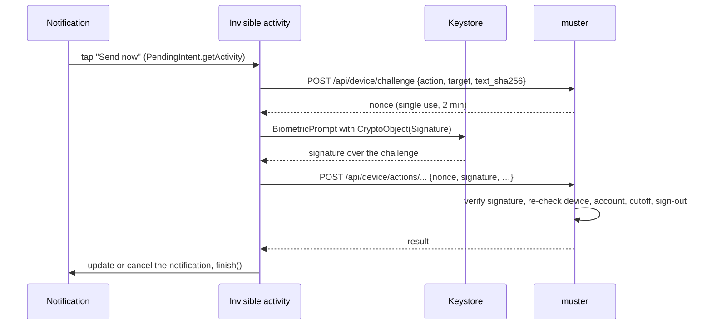

# Design: a native Android app for muster

**Status: proposed.** Nothing here is implemented, and no Phase 0 spike has
run. The operator decisions below are **decided**. Every other section is
the recommended design. Where this page states how muster works today, the
code is the authority (see [decisions.md](../decisions.md)). Where it states
how Android, UnifiedPush or a distribution channel behaves, it cites a public
source with a date. Claims no source confirmed are marked **UNVERIFIED**, and
the ones that block a decision are [Phase 0](#phase-0-spikes) spikes.

## Summary

muster already ships as an installable PWA ([push.md](../push.md)). A PWA
cannot do what the operator wants from a phone: notification buttons that act,
inline replies, chat heads, home-screen widgets, and live status. This design
adds a **native Android app** in a **new, separate repository** (called *the
app repo* below), plus the server changes muster needs to serve it.

The design, in one line each:

- **Architecture:** a Kotlin + Jetpack Compose shell that hosts muster's
  existing htmx UI in a WebView, plus native modules for notifications,
  bubbles, widgets and live status. The web UI keeps updating from the server.
- **Push:** UnifiedPush with a self-hosted ntfy distributor. UnifiedPush
  endpoints are Web Push endpoints with VAPID, so muster's existing sender is
  reused. The server change is one operator-configured exact host in the
  push allowlist.
- **Auth:** a new **device credential**, minted from a signed-in WebView
  session, so "a token cannot mint a token" still holds. It is revoked by
  account disable, the session cutoff and Sign out everywhere, and it is
  listed on Account → Devices.
- **Step-up for native actions:** each privileged action runs in a small
  invisible activity: BiometricPrompt, then a signature over a single-use
  server challenge with a biometric-bound Keystore key registered at pairing,
  then the request, then `finish()`. An inline reply cannot be
  biometric-gated, so the app holds the text and sends only after the same
  step-up.
- **Notifications:** MessagingStyle conversations per agent and per mirrored
  session, conversation shortcuts, a channel per event family, runtime
  POST_NOTIFICATIONS. A Live Update only for an agent run the user started;
  fleet status is a plain ongoing notification.
- **Chat heads:** the Bubbles API now. An always-on SYSTEM_ALERT_WINDOW
  overlay is a later, opt-in phase.
- **Widgets:** Jetpack Glance, updated from push.
- **Distribution:** sideloaded, signed APKs with a self-hosted update channel
  and an in-app updater. The package name and signing key are chosen now and
  registered for Android developer verification before its global rollout.

## Goals

- Every operator must-have (below) works on a stock, sideloaded Android phone
  without Google Play services.
- No privileged action is weaker on the phone than in the browser. Every
  server-changing notification action is gated at least as strictly as the
  web route it mirrors, and most are stricter.
- muster's web UI stays the one UI. A UI change ships from the server, and only
  native modules need an APK.
- Lock-screen privacy holds: **a notification says WHO and WHERE, never WHAT**
  ([attention.md](../attention.md)).
- The server additions follow muster's existing rules: data per user under
  row-level security, nothing cached positively, every credential revocable on
  the next request.

## Non-goals

- An iOS app. Nothing here rules one out, but the native modules are
  Android-only.
- Google Play distribution, FCM, or any dependency on Google Play services.
- A rewrite of muster's screens in Compose. Only the bubble's chrome, the
  widgets and the pairing and settings screens are native.
- Always-on floating heads in the first release. They are
  [Phase 6](#phase-6-always-on-overlay-later-opt-in), later and opt-in.
- Passkey sign-in inside the shell in the first release. Password sign-in
  works without it, and it is the optional
  [Phase 7](#phase-7-asset-links-and-passkeys-in-the-shell-later-optional).
- An app-owned background service that watches agents.
- Action buttons in the **web** service worker. `web/static/sw.js` keeps
  rendering `actions: []` (see [reconciling the sw.js test](#reconciling-the-swjs-test)).

## Operator decisions

- **Must-haves:**
  - actionable notifications. The option the operator selected read:
    "Actionable notifications: inline reply (type into the notification),
    Send now / Approve / Cancel buttons — gated by a biometric step-up";
  - overlay chat heads;
  - home-screen widgets and live status.
- **Step-up on the phone is one rule:** every state-changing action is signed
  with the biometric-bound key, refusals included. The operator chose biometric
  gating, and one rule is simpler than mirroring the web's per-route gates
  ([which actions are gated](#which-actions-are-gated)). Inline replies use the
  held-reply flow ([inline reply](#inline-reply)).
- **Chat heads: Bubbles now, an overlay as an opt-in later.** The operator
  accepted the Bubbles API in place of always-on chat heads for the first
  release. An always-on SYSTEM_ALERT_WINDOW overlay, which a sideloaded app
  may hold, is a later opt-in
  [Phase 6](#phase-6-always-on-overlay-later-opt-in).
- **Distribution:** private sideload for now, with self-hosted over-the-air
  updates. No Play Store.
- **Push transport:** whichever the research recommends. It recommends
  UnifiedPush with self-hosted ntfy ([push design](#push-design)).
- **Deliverable:** this design doc in muster. The app's code lives in a new
  repository.

## Sources and notation

Research was done for this design, mostly from developer.android.com,
firebase.google.com, unifiedpush.org, docs.ntfy.sh, f-droid.org and the
Android Developers Blog. Each claim carries its source:

- **(updated YYYY-MM-DD)** is the page's own "last updated" date;
- **(accessed 2026-10-20)** means the page showed no date;
- **UNVERIFIED** means no source confirmed the claim.

Most pages were read through a summarising fetcher. Two summaries of the
Live Update page disagreed; a later reading of the page settled it (spike S5,
closed). The full source list is at the [end](#sources).

## Architecture

### Options compared

| option | actionable push | bubbles | widgets / live status | reuses muster's UI | UI updates | native work | verdict |
|---|---|---|---|---|---|---|---|
| **TWA** (Bubblewrap) | ✗ from web; the web Notification API has no RemoteInput or BubbleMetadata | ✗ | only through a separate native path with its own auth, since the host app cannot read the web session's cookies | ✓ | server | hand-maintained: `bubblewrap update` overwrites added files | ✗ |
| **Capacitor** | custom Kotlin plugin (inline reply is iOS-only in the stock plugin) | custom plugin | custom plugin | only by loading a remote URL, which its docs call "not intended for use in production" | server (remote) or APK (bundled) | the same Kotlin as the shell, plus a JS toolchain; the stock push plugin needs FCM | ✗ |
| **Kotlin + Compose shell, WebView, native modules** | ✓ native | ✓ native | ✓ Glance, ProgressStyle | ✓ | server; native modules by APK | medium | **recommended** |
| **Fully native Compose** | ✓ | ✓ | ✓ | ✗ rewrite every screen | APK for every change | highest | ✗ |
| **Compose Multiplatform / KMP** | ✓ (Android code) | ✓ (Android code) | ✓ (Android code) | ✗ rewrite | APK | highest; pays off only for a later iOS app | ✗ |
| **React Native, Flutter** | via native modules | via native modules | via native modules | ✗ rewrite | APK (or code push) | high, plus a third-party runtime | ✗ |

The reasons for the shell:

1. Every must-have is native-only whichever wrapper is picked, so a wrapper
   saves no native work.
2. The shell keeps muster's htmx UI and its server-side updates.
3. A WebView runs service workers like Chrome, so muster's offline shell works.
4. Sign-in in the WebView is muster's own sign-in page. The password works
   there unchanged; passkeys there are an optional later item (Phase 7).
5. No third-party JS runtime to keep current.

### The shell

- **One origin.** On first run the app asks for the muster server URL (an
  `https://` origin). The app repo carries no deployment's address. The
  WebView may navigate only on that origin; any other link opens in a Custom
  Tab.
- **WebView hardening:** `setAllowFileAccess(false)`, no
  `addJavascriptInterface`, and a bridge only through
  `WebViewCompat.addWebMessageListener` with `allowedOriginRules` naming the
  exact origin, never `*`.
- **The bridge carries four messages:** the pairing code (below), "open the
  app's notification settings", "request POST_NOTIFICATIONS", and the theme. It
  never carries a credential from the app to the page.
- **No Web Push in the WebView.** WebView has no PushManager, so the page must
  not offer **Enable notifications** inside the shell. The page feature-detects
  PushManager, and in the shell it points to the app's own settings instead.
- **Cookies stay in the WebView.** The native modules never read the session
  cookie through CookieManager. They use the device credential.
- **Back and insets:** predictive back (default at targetSdk 36) maps to
  WebView history through `OnBackPressedCallback`. Edge-to-edge is mandatory at
  targetSdk 36, so the shell passes window insets to the page. How CSS
  `env(safe-area-inset-*)` behaves in a WebView is UNVERIFIED (S12).

### What lives where

| surface | built with | data from |
|---|---|---|
| Every muster page | the WebView | muster, with the session cookie |
| Notifications, actions, inline reply | native | the push payload, then `/api/device/*` |
| A bubble's expanded view | a native activity hosting a WebView on muster's compact chat page | muster, with the session cookie |
| Widgets | Glance | the last push-delivered state, in DataStore |
| Live status | native notification | the push-delivered state |
| Pairing, server URL, updates | Compose | `/api/device/*`, the update channel |

## Push design

### Comparison

| option | delivery under Doze | battery | server change | Google dependence |
|---|---|---|---|---|
| FCM | high priority wakes the device; high-priority messages that show no notification are deprioritised | lowest (shared Play services socket) | a second sender (FCM HTTP v1) and a Google service-account secret | Firebase project and Play services |
| **UnifiedPush, self-hosted ntfy** | the distributor holds a foreground-service socket and survives Doze | ntfy claims about 0–1 % per 17 h | one allowlist host, a device kind | none |
| Web Push in the WebView | impossible: WebView has no PushManager | — | — | — |
| an app-owned socket | needs a foreground service, the same permanent notification as ntfy | about the same as ntfy | a new protocol | none |

**Recommendation: UnifiedPush, with a self-hosted ntfy as the distributor.**

- Since UnifiedPush's Android spec 3.0, endpoints are Web Push endpoints:
  RFC 8291 encryption and RFC 8292 VAPID are required. muster's sender
  (`webpush-go`, aes128gcm, VAPID, `Urgency`) sends to them unchanged.
- The payload is encrypted end to end, so the ntfy server sees ciphertext.
- ntfy is a single binary that the operator can run beside muster. A
  self-hosted ntfy always uses "instant delivery", a foreground-service socket,
  which costs one permanent notification in the ntfy app.
- No Google account, no Firebase project, no Play services.
- The app uses `org.unifiedpush.android:connector` (3.3.5, Apache-2.0). An
  embedded-FCM distributor exists as a fallback, but this design does not
  ship it: whether it needs a Firebase project is UNVERIFIED (S9).

### 🔴 Only decrypted pushes are trusted

ntfy's `up*` topics are written anonymously (the access rule UnifiedPush needs
is `up*` write-only for everyone), so anyone who learns a phone's endpoint URL
can publish to it. The connector hands the app every message as
`PushMessage(content, decrypted)`, including ones it could not decrypt. So:

- The app registers with muster's VAPID public key:
  `UnifiedPush.register(…, vapid = <key>)`, where the key comes from
  `GET /api/device/config`. The distributor can then tell muster's pushes
  from others.
- **The app drops every message with `decrypted == false`**, before it
  parses anything. A message that decrypts was encrypted to this
  subscription's keys (RFC 8291), which only the phone and muster hold.
- **Widget and status deltas (`state`) are applied only from decrypted
  messages**, like everything else in the payload. A forged push can therefore
  neither draw a notification nor change a widget.
- The app still treats a decrypted payload as a hint: an action's target is
  re-read from muster before anything is shown as actionable, and muster
  re-checks everything when the action arrives.

### What muster changes

Today `AllowedPushService` (`internal/push/store.go`) admits only browser push
services, by host: FCM, Mozilla autopush, Apple and WNS, on `https` with the
default port. It is an allowlist because the endpoint is a URL a member chooses
and muster then POSTs to; without it, `fail_count` and `last_ok_at` would be a
reachability oracle for anything the pod can reach. An ntfy endpoint is
refused today.

The change:

1. **An operator-configured host list**, `MUSTER_PUSH_EXTRA_HOSTS`: exact host
   names, no suffixes, no wildcards. Empty by default, so nothing changes until
   the operator sets it. The `https`-only, default-port rule stays, so the
   ntfy server must be served on 443.
2. **Push sends refuse redirects.** Today `NewWebpushPusher`
   (`internal/push/push.go`) builds an `http.Client` with no `CheckRedirect`,
   so a send follows up to 10 redirects to **any** host, and the host
   allowlist checks only the first request. The change sets
   `CheckRedirect` to return `http.ErrUseLastResponse` and counts any 3xx as
   a failed send. This applies to every push, browser hosts included, and it
   is what makes the allowlist bound what muster connects to.
3. **No address check on the operator host.** UnifiedPush's server guidance
   says a server "should reject push endpoints that resolve to non-global IP
   addresses". That guards a server that accepts *any* host a member names.
   Here, with redirects refused, the exact-host allowlist bounds where a push
   can go: a member chooses only the path on a host the operator named. An
   address check would also refuse an in-cluster ntfy whose name resolves to a
   private address under split-horizon DNS, which is a reasonable deployment.
   So the operator host uses the same client as the browser hosts. Spike S10
   checks that muster and the phone reach ntfy by the same name.
4. **A test push on registration.** As UnifiedPush recommends, a new device
   endpoint is accepted only after muster has sent it a VAPID test push and got
   a 2xx response.
5. **A device kind** on each subscription (`browser` or `android`), so native
   devices get payload v2, the native-only events, and the silent `resolved`
   withdrawal that Safari subscriptions are spared today. Payload v2 for the
   existing events, and the silent `resolved`, ship in Phase 1; the
   native-only events come with the phases that use them.

### Payload v2

Native devices get a payload that carries **ids, not content**:

```json
{"v": 2, "type": "attention", "id": "…", "tag": "…",
 "conv": "agent:<name>",
 "title": "<WHO>", "body": "<WHERE>",
 "actions": ["answer", "cancel"],
 "state": {"attention": 3, "review": 1}}
```

- `title` and `body` obey WHO and WHERE, never WHAT, exactly as today.
- `actions` names action ids. The app maps each id to a fixed button and a
  fixed `/api/device/actions/*` route, so the server cannot make the app POST
  to an arbitrary path.
- `state` is a small delta for widgets and live status.
- Anything longer (a question's text, a draft, the last messages of a
  conversation) is fetched after delivery with the device credential, and is
  shown only on an unlocked phone ([notifications](#notifications)).
- The payload stays small. A 4 KB budget is ntfy's general guidance and is
  UNVERIFIED for UnifiedPush specifically.

New event types, sent to `android` devices only:

| event | when | notes |
|---|---|---|
| `message` | a dispatched agent replied, or a mirrored Claude Code session finished a turn | feeds conversation notifications and bubbles |
| `queue` | a window's send queue changed | feeds the queued-messages notification with **Send now** and **Cancel** |
| `status` | the fleet's state changed | silent; feeds widgets and live status; coalesced to at most one per device per 30 s |

## Auth and step-up design

### What muster has today

- Browser sessions are HttpOnly, Secure cookies. In gotrue mode only the
  browser listener serves them ([auth.md](../auth.md)). The reverse holds too:
  in gotrue mode the browser listener refuses the shared hook and service
  tokens and admits only personal `mst_` tokens on the `/api/` tier
  (`refuseSharedTokenOnBrowserListener` in `internal/api/auth.go`).
- `mst_` personal tokens act as their user, are minted only in a browser, and
  cannot mint another token. Revocation and disable are read on every call.
- Step-up freshness is the sign-in time of **the session presented**
  (`amr` in gotrue mode, the cookie's issue time in password mode), inside
  `MUSTER_STEPUP_WINDOW` (default 12 h). "Freshness belongs to one browser
  session, never to the user"
  ([decisions.md](../decisions.md#step-up-twelve-hours-per-browser-session)).
- A queued message's step-up is decided when it is queued, and re-checked from
  the stored row when it is sent
  ([sending-and-step-up.md](../sending-and-step-up.md#queue-send-when-claude-code-is-idle)).

A notification action has no browser session, so none of this applies as is.

### The device credential

- **A new credential kind**, `mdv_…`, one per paired phone. It is opaque, only
  its sha256 is stored, and it is shown to the app once.
- **It is confined to `/api/device/*`.** Every other route refuses it, as
  every other route refuses a plugin's `mpl_` token. A stolen device
  credential therefore cannot use the rest of the API.
- **Which listener.** The phone reaches muster through the public edge, which
  is the browser listener in gotrue mode, and that listener admits only `mst_`
  on `/api/` today. So the device tier is admitted on the browser listener
  **for `/api/device/*` only** (server change 29); the shared tokens stay
  refused there. In password mode there is one listener and nothing changes.
- **Minted from a signed-in session.** A page in the WebView calls
  `POST /account/devices/pair` with its session cookie. That route needs a
  sign-in from the last five minutes, the rule for adding a passkey, because
  the key it enrols outlives the session. It returns a one-time pairing code
  (single use, 60 s, stored as a hash). The page hands the code to the app over
  the bridge, and the app redeems it at `POST /api/device/pair` for the
  credential. A device credential cannot ask for a pairing code, so "a token
  cannot mint a token" still holds.
- **Revocation, read on every request, nothing cached:**
  - the user removes the device on Account → Devices, or the app unpairs;
  - the account is disabled;
  - the pairing session's sign-in is at or before the account's session
    cutoff (moved by a disable or a password reset);
  - the pairing session's sign-in is at or before the account's latest
    **Sign out everywhere** (gotrue mode only). This one is a **recommendation** of this design,
    not an operator requirement: it is what that button is expected to mean.
    It is stricter than `mst_` tokens, which Sign out everywhere does not
    revoke today. A phone is a session-like thing, and "everywhere" should
    include it. It gets its own [decisions.md](../decisions.md) note (server
    change 25).
- **Account → Devices** lists each device: its name, app version, when it was
  paired, when it was last seen, and whether push is registered. Each has a
  **Remove** button. The 20-device limit per owner that push subscriptions
  already have applies here too.
- **On the phone** the credential is stored in DataStore, encrypted with
  AES-GCM under a Keystore key. `EncryptedSharedPreferences` is deprecated.
  Tokens are excluded from Auto Backup.

### The step-up key

At pairing the app generates a second key, **in Phase 1**, so every paired
phone has one before the signed actions of Phase 2 exist: an EC P-256 signing
key in the Android Keystore with

- `setUserAuthenticationRequired(true)`;
- `setUserAuthenticationParameters(0, AUTH_BIOMETRIC_STRONG)`: a fresh
  biometric on **every** use;
- `setInvalidatedByBiometricEnrollment(true)`: enrolling a new fingerprint or
  face destroys the key.

The public key is sent with the pairing request and stored on the device row.
A phone without a strong biometric cannot create the key; it pairs read-only
(notifications, widgets, no actions) until [open question](#open-questions) 3
is settled.
If the key is invalidated, the app shows "Re-confirm this phone", which sends
the user to a fresh pairing in the WebView.

### A gated action, step by step



- **The activity** is a translucent `FragmentActivity` with no UI of its own,
  started straight from the notification's `PendingIntent.getActivity`. On
  targetSdk 31+ an activity cannot be started from a receiver or service that a
  notification launched (the trampoline rule), and BiometricPrompt needs a
  FragmentActivity or Fragment.
- **`setAuthenticationRequired(true)`** is set on every privileged action as
  well. It means only "the device must be unlocked", not a biometric, so it is
  defence in depth and not the gate.
- **The challenge** is bound to the device, the action, the target id and, for
  a message, the sha256 of the exact text. It is single use, expires after
  2 minutes, and lives in the database so it holds across a rolling update.
- **The server** verifies the signature against the stored key, re-reads the
  device, account, cutoff and Sign out everywhere state, marks the nonce used,
  and performs the action in the same handler as the cookie route, under the
  owner's own principal. A failure says why, and the app shows it in the
  notification.
- **Freshness is per action.** A verified signature counts as a sign-in at the
  moment of verification, so the device route can hand the existing handlers a
  step-up time through the same context value the session routes use. This is
  stricter than the 12-hour window, and it is a **new freshness source**, which
  needs its own [decisions.md](../decisions.md) entry when it is built.
- **Password mode** works the same way for step-up: pairing needs a fresh
  cookie, and the signature is the freshness. Revocation differs: Sign out
  everywhere exists only in gotrue mode, so in password mode a device is cut
  off by removing it on Account → Devices.

### Inline reply

The design delivers the RemoteInput result to a BroadcastReceiver, so a
reply does not open an activity over whatever the user is doing. (The reply
PendingIntent could target an activity instead; that would allow a prompt at
once but loses the inline experience.) There is no biometric on that path,
and the text may not even have been typed by the user: a notification
listener or a paired wearable can fill RemoteInput too. So:

1. The app keeps the reply **on the phone**, encrypted, and replaces the
   notification with a held-reply notification that **shows the exact held
   text** in its private (unlocked) version, with a **Confirm and send** action
   and a **Discard** action. Its public (lock-screen) version says only
   "Reply held for <WHO>".
2. **Confirm and send** runs the gated flow above, with the text's sha256 in
   the challenge, and **the BiometricPrompt's description repeats the exact
   text** (truncated with a visible marker when long, with **Discard** offered
   instead of sending a text the user cannot fully see). The hash binding means
   something only because the user sees what they approve.
3. The confirmed reply goes to the route its conversation uses: an agent's
   send, an ask's answer, or a mirrored window's **queue**. For a mirrored
   window it is queued, never pasted at once, so it waits for idle like any
   queued message.

This matches muster's rule that "step-up for a queued message is decided when
you queue it": the confirmed step-up **is** the queueing act, and the queued
row records the signature's time as its step-up time. The server never holds
unconfirmed text, so a phone lost with a held reply loses only that reply.

A server-held queue of unconfirmed replies was considered and rejected: it
adds a table, and it would put text on the server that the user never
confirmed.

### Which actions are gated

| action | web route today | web gate | native gate |
|---|---|---|---|
| Send now | `POST /send-queue/{id}/send-now` | fresh sign-in (12 h) | biometric signature |
| Cancel a queued message | `POST /send-queue/{id}/cancel` | none | biometric signature |
| Approve a reply draft | `POST /plugins/drafts/{id}/approve` | fresh sign-in (12 h) | biometric signature |
| Reject a reply draft | `POST /plugins/drafts/{id}/reject` | none | biometric signature |
| Answer an ask (option or text) | `POST /attention/asks/{id}/answer` | none | biometric signature |
| Dismiss an ask | `POST /attention/asks/{id}/cancel` | none | biometric signature |
| Message an agent | `POST /agents/{name}/send` | none | biometric signature |
| Queue into a mirrored window | `POST /send-queue` | fresh sign-in (12 h) | biometric signature |

**Decided by the operator: one rule. Every action that changes server state
is signed.** The operator chose biometric gating for the phone's actions, and
one rule is simpler than mirroring the web's per-route gates. It is stricter
than the web, where refusing (Cancel, Reject, Dismiss) needs no fresh sign-in
because "refusing to send is never the risky direction". On a phone a lost
device credential is the threat, and a single rule leaves nothing to get wrong
per action.

### Native passkeys are not on the path

Neither the step-up nor sign-in depends on passkeys:

- **Step-up** uses the Keystore device key above. A passkey assertion made by
  a native app presents an `android:apk-key-hash:<hash of the signing
  certificate>` origin, not `https://…`, and whether GoTrue accepts that origin
  is UNVERIFIED.
- **Sign-in in the shell** uses muster's sign-in page with the password, which
  stays mandatory in muster anyway.

Passkey sign-in inside the WebView (Credential Manager's "for app" mode, which
needs Digital Asset Links) is the optional
[Phase 7](#phase-7-asset-links-and-passkeys-in-the-shell-later-optional), with
its spikes S1 and S2.

## Server changes

Numbered for the [phased plan](#phased-plan). Migration numbers are the next
free ones when each phase lands.

**Configuration**

1. `MUSTER_PUSH_EXTRA_HOSTS`: operator push hosts (exact names, `https`,
   default port).
2. *Later, optional (Phase 7):* `MUSTER_ANDROID_APP`: the package name and the
   SHA-256 fingerprints of the signing certificates, for asset links. Unset
   means no asset-links file. Pairing does not depend on it.
3. `MUSTER_ANDROID_UPDATE_URL` (optional): the update channel's manifest URL,
   which paired devices read from `/api/device/config`.
4. Rows for each variable in [configuration.md](../configuration.md), which a
   test requires, added in the phase that adds the variable.

**Migrations**

5. `devices`: `id`, `owner_id` (under FORCE row-level security, like
   `push_subscriptions`), `name`, `app_version`, `token_sha256` (unique),
   `stepup_pubkey` (SPKI), `paired_signin_at` (the pairing session's sign-in
   time, for the cutoff and Sign out everywhere checks), `created_at`,
   `last_seen_at`, `revoked_at`.
6. `device_pairing_codes`: `code_sha256`, `owner_id`, `signin_at`,
   `expires_at`, `used_at`.
7. `device_challenges`: `nonce`, `device_id`, `action`, `target`,
   `text_sha256`, `expires_at`, `used_at`. Swept when expired.
8. `push_subscriptions`: add `kind` (`browser` | `android`, default
   `browser`) and a nullable `device_id`, cascading on device removal.

**Routes, session tier (browser listener, same origin)**

9. `POST /account/devices/pair`: a sign-in from the last five minutes; returns
   a pairing code.
10. `POST /account/devices/{id}/remove`, and the Account → Devices section on
    `/account`.

**Routes, device tier (`mdv_` only, confined to `/api/device/*`)**

11. `POST /api/device/pair`: redeems a pairing code (no credential needed;
    throttled like sign-in) with `{name, app_version, stepup_pubkey}`;
    returns the credential once.
12. `DELETE /api/device`: unpair this device.
13. `PUT /api/device/push` and `DELETE /api/device/push`: register or remove
    the UnifiedPush endpoint `{endpoint, p256dh, auth}`, with the test push.
14. `GET /api/device/config`: the VAPID public key, server version, update
    channel, and the feature switches the app needs.
15. `GET /api/device/state`: counts and per-agent status for widgets and live
    status.
16. `GET /api/device/items/{kind}/{id}`: the text of one ask, draft or
    queued message, for an unlocked phone.
17. `GET /api/device/conversations/{key}`: the last few messages of an agent
    or session conversation, for MessagingStyle.
18. `POST /api/device/challenge`: a single-use nonce for one action.
19. Signed action routes, each taking `{nonce, signature}` plus the web route's
    own fields and its one-time message nonce, so a retried action is applied
    once:
    - `POST /api/device/actions/send-queue/{id}/send-now`
    - `POST /api/device/actions/send-queue/{id}/cancel`
    - `POST /api/device/actions/send-queue` (queue into a mirrored window)
    - `POST /api/device/actions/attention/asks/{id}/answer`
    - `POST /api/device/actions/attention/asks/{id}/cancel`
    - `POST /api/device/actions/plugins/drafts/{id}/approve`
    - `POST /api/device/actions/plugins/drafts/{id}/reject`
    - `POST /api/device/actions/agents/{name}/send`

**Public routes (later, optional: Phase 7)**

20. `GET /.well-known/assetlinks.json`: `delegate_permission/common.get_login_creds`
    and `delegate_permission/common.handle_all_urls` for the configured
    package and fingerprints; HTTP 200, `application/json`, no redirect. The
    deployment's edge must serve it without a redirect too.

**Push and UI**

21. `AllowedPushService` also admits the operator hosts (item 1), by exact
    name only; the sender refuses redirects and counts a 3xx as a failed send,
    for every push (`CheckRedirect` returns `http.ErrUseLastResponse`).
22. Payload v2 for `android` devices: (a) the existing events and the silent
    `resolved` withdrawal (Phase 1); (b) the `message` and `queue` events
    (Phase 2); (c) the `status` event (Phase 4, with item 28).
23. A compact chat layout for a bubble (a query parameter on the existing
    agent and session pages: no header, no navigation).
24. Inside the shell, the page hides **Enable notifications** and
    **Install**, and links to the app's settings over the bridge.

**Docs and tests**

25. [decisions.md](../decisions.md) entries: native notification actions, and
    why the web worker still has none; the device key as a freshness source;
    device credentials revoked by Sign out everywhere (a recommendation of
    this design, recorded as the expected meaning of that button).
26. A route ledger test: every action id payload v2 can name maps to a
    registered `/api/device/actions/*` route, and every such route is in the
    ledger. This is the native counterpart of the service-worker test below.
27. A tier test: an `mdv_` credential is refused on every route outside
    `/api/device/*`, and a session cookie is refused on the `/api/device/*`
    routes.

**Added after review**

28. The `status` push, and `/api/device/state`, record **who started each
    run**: the user through a session or the app, versus the chief, a plugin
    or a machine token. Only a user-started run is promoted to a Live Update.
29. The device tier on the browser listener: in gotrue mode, admit `mdv_` on
    the browser listener for `/api/device/*` only. Shared hook and service
    tokens stay refused there, and `mdv_` stays refused everywhere else.

### Reconciling the sw.js test

`TestServiceWorkerOffersNoDecisionButtons` reads the shipped `web/static/sw.js`
and fails if it contains a decision route or an approve or deny action. The
routes it bans are the removed privilege route and the **permission router's**
decision route, which muster does not register and never will. The test exists
so that no button POSTs to a 404.

This design does not touch that file or that test:

- the web worker keeps `actions: []`;
- the native actions target muster's own routes, under `/api/device/actions/*`,
  and are defined in the app, not in `sw.js`;
- the new route ledger test (item 26) carries the same intent to the native
  side: no button the server can offer maps to a route that does not exist.

Re-adding actions is still a decision of its own, with its own gate (the
signed action) and its own [decisions.md](../decisions.md) entry (item 25).

## Notifications

- **Permission.** POST_NOTIFICATIONS (API 33) is asked for after pairing,
  with a line saying what is lost without it. The app checks
  `areNotificationsEnabled()` and shows the state in its settings.
- **Channels:**

  | channel | importance | carries |
  |---|---|---|
  | Asks and approvals | high | `attention`, `plugin`, `connector` |
  | Conversations | high, conversation | `message` |
  | Queued messages | default | `queue` |
  | Tasks | default | `review`, `created`, `comment`, `agent` |
  | Agent run | default; not MIN, so it can be promoted | the Live Update |
  | Fleet status | low, ongoing | the fleet summary |

- **Conversations.** One conversation per dispatched agent, per mirrored Claude
  Code session and for the chief: MessagingStyle, a `Person`, a long-lived
  dynamic shortcut (`setLongLived(true)`, `setPerson`, `setLocusId`) linked by
  `setShortcutId`. Conversations get the conversation space, priority marking
  and bubbles. Each conversation has a unique PendingIntent request code, or a
  reply can land in the wrong one.
- **Lock screen.** Every notification is `VISIBILITY_PRIVATE`, with a public
  version holding only WHO and WHERE. The private version may show the
  question, draft or messages, fetched with the device credential. Whether
  every launcher honours the public version is UNVERIFIED (S11); until it is
  measured, the app shows WHAT only after the user opts in.
- **Actions per event:**

  | event | actions |
  |---|---|
  | `attention` (agent question) | up to two of the asker's options, and **Answer** (inline reply) |
  | `attention` (mirrored Claude Code question) | Open only. A session's `AskUserQuestion` has no `/attention/asks/{id}/answer` route; it is answered in the session's rendered view |
  | `attention` (session waiting) | Open |
  | `plugin` | **Approve and send**, **Reject** |
  | `queue` | **Send now** (the next message), **Cancel** |
  | `message` | **Reply** (inline) |

  Every one that changes server state is signed ([step-up](#a-gated-action-step-by-step)).
- **Withdrawal.** `resolved` cancels by tag, as the web worker does.
- **PendingIntents** are `FLAG_IMMUTABLE` with explicit components, except
  the RemoteInput and bubble intents, which must be `FLAG_MUTABLE`.

## Bubbles (chat heads)

- **The Bubbles API, not SYSTEM_ALERT_WINDOW.** A bubble is a conversation
  notification with `BubbleMetadata` (intent, icon, `setDesiredHeight`). Its
  expanded activity is `resizeableActivity="true"` and `allowEmbedded="true"`.
  It needs no special permission. As of Android 17, bubbles are a windowing
  mode of their own.
- **What is in it:** a small activity hosting a WebView on muster's compact
  chat page (server change 23) for that agent or session. The WebView shares
  the app's cookie store, so it is signed in, and every gate the web UI has
  applies unchanged, the 12-hour step-up for mirrored sends included.
- **The limits, stated plainly:**
  - a bubble exists only while that conversation has a notification;
  - the user chooses, per app and per conversation, whether bubbles appear;
    only priority conversations bubble automatically;
  - there is no always-on floating head. That is
    [Phase 6](#phase-6-always-on-overlay-later-opt-in).

## Always-on overlay (later, opt-in)

The operator wants chat heads that stay on screen without a notification. A
sideloaded app may ask for SYSTEM_ALERT_WINDOW ("display over other apps"), so
this is buildable. It is a later phase, off by default, turned on per phone in
the app's settings.

- **The permission.** The user grants it in Settings, through
  `ACTION_MANAGE_OVERLAY_PERMISSION`. The app re-checks `canDrawOverlays()`
  on every start and turns the overlay off, saying why, when it is revoked.
- **A foreground service with a declared type.** An overlay window lives only
  as long as something hosts it, so a foreground service owns the
  `TYPE_APPLICATION_OVERLAY` window. Since Android 14 every foreground service
  declares a `foregroundServiceType` and its matching permission:
  - **`specialUse`**, with its required subtype property naming the use
    ("chat-head overlay"). It is the only fitting type;
  - not `dataSync`: Android 15 caps it at 6 h per 24 h, and it cannot start
    from `BOOT_COMPLETED`;
  - not `remoteMessaging`: that type is for transferring text messages, and
    this service transfers nothing.
  - The service shows its own ongoing notification, which is the cost of the
    overlay.
- **Its battery cost.** The service holds no socket. ntfy already does, and
  the head's badge and preview are updated by the same pushes as the widgets.
  Its cost is one resident process and one ongoing notification. No source
  gives a figure: spike S6 measures it against the ntfy baseline (about 0–1 %
  per 17 h, by ntfy's own claim).
- **Android 12's untrusted touches.** A `TYPE_APPLICATION_OVERLAY` window is
  untrusted: a touch that would pass *through* it to another app is blocked
  unless the window is at most 0.8 opaque, or invisible. So:
  - the head is a small window sized to its content, with
    `FLAG_NOT_TOUCH_MODAL` and `FLAG_NOT_FOCUSABLE`, so touches outside it reach
    the app below normally;
  - the expanded chat panel is focusable while open, and it closes on an outside
    tap instead of letting the tap through;
  - no full-screen translucent layer, ever.
- **Android 15's foreground-service gating.** An app holding the permission may
  start a foreground service from the background **only while it has a visible
  overlay window**. After a reboot, or after the system kills the process, there
  is no visible window, so the service cannot restart itself from the
  background. The head comes back when the user opens the app or taps a muster
  notification, both of which are allowed starts. The app says so in the
  overlay setting, rather than promising "always".
- **What it shows:** the same conversations as the bubbles, using the same
  compact chat page in a WebView, under the same gates. A head is not drawn on
  the lock screen.
- **Holding the permission also exempts the app from background
  activity-start limits.** The design does not rely on that: the step-up
  activity is still started only from a notification or from the head's own
  tap.
- **Spike S6, moved here from Phase 0:** check the platform's rules for
  granting the permission (including the Android Go limitation), confirm that
  `specialUse` is accepted for this use on current Android, measure battery
  over 24 h with the head on, and measure how restarts behave on Android 15 and
  later.
- **Effort:** server 0–0.5 days (a feature switch in `/api/device/config`),
  app 6–8 days including S6.

## Widgets

- **Jetpack Glance** (1.2.0 stable).
- **Widget 1, Attention:** the attention count, the review count, and the next
  item as WHO and WHERE. A tap opens `/attention` in the shell.
- **Widget 2, Agents:** each agent's name and status (running, waiting for
  you, idle, failed). A tap opens that agent.
- **Updates come from push.** The push handler writes the `state` delta to
  DataStore and calls `updateAll`. WorkManager runs a catch-up read of
  `/api/device/state` (15 minutes at the shortest) for pushes that were missed.
  `updatePeriodMillis` is not used for freshness.
- **Limits:** on targetSdk 37, RemoteViews bitmaps have a memory cap; the
  widgets draw no images beyond icons.

## Live status

- **A Live Update only for a run the user started.** When the user dispatches
  an agent, from the shell or a notification, the app shows a promoted ongoing
  notification for that run (`setRequestPromotedOngoing(true)`, a
  `contentTitle`, ProgressStyle with an indeterminate tracker, and points for
  "started", "waiting for you" and "ready for review"). It ends when the task is
  ready for review or the agent stops. The app declares
  `POST_PROMOTED_NOTIFICATIONS` (a normal, install-time permission), checks
  `canPostPromotedNotifications()`, and offers
  `ACTION_MANAGE_APP_PROMOTED_NOTIFICATIONS` when promotion is off. Android's
  guidance is that Live Updates are for user-initiated journeys, and its
  Live Update page says "Don't allow activities triggered by other parties"
  and "Don't show ambient information". So a run the chief or a machine
  started is never promoted, and fleet status is not a Live Update. Knowing
  who started a run needs server change 28.
- **Fleet status is a plain ongoing notification** on the low-importance
  channel: for example "3 running · 1 waiting". It is opt-in.
- **No watcher service.** Android 15 caps `dataSync` foreground services at 6 h
  per 24 h, Android 16 applies job quotas even in the foreground, and a
  self-hosted ntfy already holds the one socket the phone needs. Live status is
  updated by `status` pushes, coalesced on the server, with WorkManager as the
  fallback.

## Distribution and over-the-air updates

### Channel

| option | infrastructure | unattended updates | verdict |
|---|---|---|---|
| **In-app updater** (PackageInstaller) against a self-hosted channel | a static HTTPS host: one manifest plus APKs | yes, for a self-updating installer at a high enough targetSdk | **recommended** |
| GitHub Releases + Obtainium | none | Obtainium's mechanism is UNVERIFIED (S8) | supported as an alternative |
| Self-hosted F-Droid repo | a static host plus `fdroid` tooling | through an F-Droid client | heavier; not needed for one app |
| Accrescent | — | — | not viable: new submissions unlikely, no private apps |
| Play internal testing | Play Console | yes | excluded by the operator decision |

**The in-app updater:**

- The channel is a manifest, `{version_code, version_name, url, sha256,
  min_supported}`, and the APKs, on any static HTTPS host the operator runs.
  muster tells paired devices where it is (`MUSTER_ANDROID_UPDATE_URL`,
  through `/api/device/config`), so the app repo carries no address.
- The app checks on start and daily through WorkManager, downloads, checks the
  sha256 **and** that the APK's signing certificate matches its own, and only
  then commits a PackageInstaller session. Android also refuses an update
  signed by another key.
- **Silent self-update** uses `setRequireUserAction(USER_ACTION_NOT_REQUIRED)`
  (API 31+). Following that method's documentation, every one of these must
  hold, or the install prompts the user:
  - the app declares `REQUEST_INSTALL_PACKAGES` (required for any install) and
    the user has turned on "install unknown apps" **for the muster app
    itself** (not only for the browser that installed it the first time);
  - the app is updating itself, or is the installer of record or the update
    owner (or holds `UPDATE_PACKAGES_WITHOUT_USER_ACTION`, which the method's
    documentation names as the permission for this; whether a sideloaded app
    must declare it to be silent is checked when Phase 5 is built);
  - its targetSdk is high enough for the phone's Android version: 33+ on
    Android 15, 34+ on Android 16 (API 36), 35+ on API 37.
  - If any is not met, **every** update shows the system install prompt. The
    app must handle `STATUS_PENDING_USER_ACTION` either way.
- The first install needs the "install unknown apps" permission for the
  browser or file manager used.
- GitHub Releases on the app repo carry the same APKs, so Obtainium also works
  for anyone who prefers it.

### Signing-key custody

- One release key, generated offline, kept offline, with an encrypted backup
  in a second place. Losing it means no update can ever be installed over the
  app, and the package cannot be registered for developer verification.
- **CI never holds the release key.** CI builds an unsigned release APK and a
  debug-signed test APK. The operator signs the release offline with
  `apksigner` (zipalign first; v2 and v3 schemes) and publishes it
  ([release pipeline](#release-pipeline)).
- Record the certificate's SHA-256 fingerprint. It goes into the developer
  verification registration, and into `MUSTER_ANDROID_APP` if the optional
  asset links are built (Phase 7).
- Key rotation, if ever needed, uses `apksigner rotate` and a signing lineage.

### 🔴 Android developer verification

Google is requiring that apps installed on certified Android devices come from
a registered developer
([blog, updated 2026-09-29](https://android-developers.googleblog.com/2026/03/android-developer-verification-rolling-out-to-all-developers.html)):

| when | what |
|---|---|
| August 2026 | limited-distribution accounts and the "advanced flow" available everywhere |
| from 2026-09-30 | enforced in Brazil, Indonesia, Singapore and Thailand |
| 2027 and later | the global rollout |

- **ADB installs are exempt.** Without ADB, an unregistered app needs the
  advanced flow: a one-time setup in Developer options with a 24-hour wait,
  then a warning on every install. Whether that warning also stops every
  over-the-air update, and so makes silent updates impossible, is UNVERIFIED
  (S7) but likely.
- **Two ways to register:**

  | account | cost | identity | limit | fit |
  |---|---|---|---|---|
  | Limited distribution | free | Google account with 2-step verification and a payments profile; no government ID | up to 20 devices, each authorised by its user | framed for hobbyists and learners with "no commercial intent"; whether that is binding is unclear |
  | Full | $25 | government ID | none | the clean choice for a tool used for work |

- **Recommendation: choose the package name and the release key now**, since
  both are fixed at registration, and register with a **full account** before
  the global rollout. Nothing is enforced in the operator's country today, so
  this does not block Phase 1.
- F-Droid publicly opposes verification and advises developers not to
  register. Not registering keeps the app installable only through ADB or the
  advanced flow after the global rollout.

## Security

- **TLS:** a network security config with `cleartextTrafficPermitted="false"`
  and no user-added CAs in release builds.
- **No certificate pinning.** Android's guidance does not recommend it, and a
  deployment behind a CDN or proxy that rotates certificates would break on
  every rotation.
- **Secrets on the phone:** the device credential in DataStore, encrypted with
  AES-GCM under a Keystore key. The step-up key never leaves the Keystore and
  needs a strong biometric on every use. `android:allowBackup` is off, or the
  data-extraction rules exclude the token store.
- **WebView:** one origin, origin-restricted message listener, no file access,
  no `addJavascriptInterface`, other origins in a Custom Tab.
- **Components:** only the launcher activity, the bubble activity and the
  UnifiedPush receiver are exported. The invisible step-up activity is not
  exported and is reachable only through the app's own PendingIntents.
- **SDK levels:** minSdk 30 (conversations and bubbles everywhere; passkeys
  need 28, direct reply 24, Glance 23). targetSdk 36 now, planned 37. These
  also satisfy the PackageInstaller silent-update table.
- **Platform defaults at targetSdk 36:** edge-to-edge, predictive back,
  and orientation locks ignored on large screens. The shell is built for all
  three.
- **Server side:** every `/api/device/*` route is throttled per device and per
  address; pairing codes and challenges are single use; nothing about a
  device is cached positively.

## Phased plan

Efforts are rough engineer-days, including tests and docs. **Server** is work
in muster; **app** is work in the app repo.

| phase | what | server | app | depends on |
|---|---|---|---|---|
| **0** | Spikes S3, S4 and S7–S12 ([below](#phase-0-spikes)) | 0.5 | 2–3 | — |
| **1** | Shell and push. Server: items 1, 4, 5, 6, 8–14, 21, 22a, 24, 27, 29; Account → Devices. App: project and modules, server-URL screen, hardened WebView with password sign-in, bridge, pairing with the step-up key, encrypted token store, UnifiedPush registration with the VAPID key and the decrypted-only filter, channels, POST_NOTIFICATIONS, payload v2 notifications for the existing events and `resolved` withdrawal, the CI build and the offline signing script. | 6–7 | 8–10 | 0 |
| **2** | Actionable notifications. Server: items 7, 16–19, 22b, 25, 26. App: the invisible activity, the signed action client, inline reply with the held reply shown in the notification and the prompt, MessagingStyle conversations and shortcuts, lock-screen public versions. | 6–8 | 7–9 | 1 |
| **3** | Bubbles. Server: item 23. App: bubble metadata, the expanded activity, per-conversation bubble settings. | 1–2 | 3–4 | 2 |
| **4** | Widgets and live status. Server: items 15, 22c (the `status` event, coalesced) and 28. App: two Glance widgets, the fleet ongoing notification, the Live Update for user-started runs, the WorkManager catch-up. | 3.5–4.5 | 5–6 | 1 |
| **5** | Updates and verification. Server: item 3. App: the in-app updater (manifest, sha256 and certificate checks, PackageInstaller, pending-user-action handling), the channel publishing script, developer verification registration. | 0.5–1 | 4–5 | 1 |
| *6, later, opt-in* | The always-on overlay ([below](#phase-6-always-on-overlay-later-opt-in)), with spike S6. Server: a feature switch in `/api/device/config`. App: the overlay permission flow, the `specialUse` foreground service, the head and its expanded panel, restart handling, the battery measurement. | 0–0.5 | 6–8 | 3 |
| *7, later, optional* | Asset links and passkeys in the shell ([below](#phase-7-asset-links-and-passkeys-in-the-shell-later-optional)), with spikes S1 and S2. Server: items 2 and 20, and the edge serving the file without a redirect. App: Credential Manager in the WebView. | 1–1.5 | 1–2 | 1 |

Totals for Phases 0–5: **server 17.5–23 days**, **app 29–37 days**. The later
Phases 6 and 7 add **server 1–2** and **app 7–10**. Phases 3, 4 and 5 are
independent after their dependencies. The shortest useful slice is Phases 0–2:
a paired phone with signed Send now, Approve and Cancel, and inline replies.

### Phase 0 spikes

Each spike is the UNVERIFIED item a decision rests on. S1 and S2 belong to
Phase 7, and S6 to Phase 6; the numbers are kept so references stay stable.

| id | question | decides |
|---|---|---|
| S3 | Can BiometricPrompt sign with an EC P-256 key through a CryptoObject from a translucent, UI-less FragmentActivity started by a notification action, on the lock screen and unlocked? (And: is an activity really required?) | the step-up activity's shape |
| S4 | Can a key use `AUTH_BIOMETRIC_STRONG \| AUTH_DEVICE_CREDENTIAL` with a timeout of 0, so a phone without a strong biometric can still sign? | [open question](#open-questions) 3 |
| ~~S5~~ | **Closed.** The Live Update page says "Don't allow activities triggered by other parties" and "Don't show ambient information", so only user-started runs are promoted. Whether promotion works on a sideloaded app is checked in Phase 4 itself. | — |
| S7 | Developer verification: are browser and file-manager installs blocked in the enforcing countries; can limited-distribution devices be swapped; is "no commercial intent" binding; how do unattended updates of an unregistered app behave after the global rollout? | full or limited account, and the timing |
| S8 | Obtainium's unattended-install mechanism; F-Droid index v2 client compatibility | whether Obtainium is a full alternative channel |
| S9 | Does ntfy require VAPID on `up*` publishes; which foreground-service type does ntfy use; does the embedded-FCM distributor need a Firebase project? | ntfy's access config, battery claims, the fallback |
| S10 | Does muster reach ntfy by the exact name in the endpoint ntfy gives the phone, on `https` and the default port, whether that name resolves inside the cluster (split horizon) or publicly? | ntfy's base URL, and the value of `MUSTER_PUSH_EXTRA_HOSTS` |
| S11 | Do the phone's launcher and lock screen show only the public version of a `VISIBILITY_PRIVATE` notification? | whether WHAT can be shown unlocked |
| S12 | Do CSS `env(safe-area-inset-*)` values work in an edge-to-edge WebView? | whether the page or the shell pads for insets |

### Phase 6: always-on overlay (later, opt-in)

The design is in [always-on overlay](#always-on-overlay-later-opt-in). Its spike:

| id | question | decides |
|---|---|---|
| S6 | The platform's rules for granting SYSTEM_ALERT_WINDOW (including the Android Go limitation); whether `specialUse` is accepted for an overlay host on current Android; the battery cost over 24 h against the ntfy baseline; how restarts behave under Android 15's gating | whether the overlay ships, and what its setting promises |

### Phase 7: asset links and passkeys in the shell (later, optional)

Not needed for anything above: sign-in in the shell uses the password, and the
step-up uses the Keystore device key. Built only if passkey sign-in inside the
app is wanted.

| id | question | decides |
|---|---|---|
| S1 | Does GoTrue accept an `android:apk-key-hash:` entry among its allowed WebAuthn origins? | whether native passkeys are ever an option |
| S2 | Which origin does a WebView in `WEB_AUTHENTICATION_SUPPORT_FOR_APP` mode put in clientDataJSON, and from which WebView version does it work? | whether passkey sign-in works in the shell with no GoTrue change |

Also not verified, and not blocking: the Android 17 release date; whether
Android 16 changed widgets; Compose's minSdk; Tink with DataStore as official
guidance; the Play fee.

## Risks

- 🔴 **A lost or stolen phone.** The device credential alone can read counts,
  item text and conversations through `/api/device/*`, but every
  state-changing action needs the biometric key. Removing the device, Sign out
  everywhere, or a disable cuts it off on the next request.
- **Biometric enrolment changes** destroy the step-up key. The phone falls back
  to "Re-confirm this phone"; that is the intended cost.
- **Push depends on a second service.** If ntfy is down, nothing arrives. The
  WorkManager catch-up keeps widgets roughly current, and the web UI still
  works.
- **The ntfy app's permanent notification** and its battery use are the price
  of not using FCM.
- **The push allowlist trusts the operator's host list.** With no address
  check, a wrong entry in `MUSTER_PUSH_EXTRA_HOSTS` lets members make muster
  POST to that host. The list is exact names, set only by the operator, and
  empty by default, and with redirects refused (server change 21) a push
  cannot be bounced from a listed host to an unlisted one.
- **The overlay (Phase 6) cannot promise "always".** Under Android 15's
  gating it does not come back by itself after a reboot or a kill, and it costs
  a second ongoing notification and a resident process.
- **Developer verification** could make sideloaded updates noisy or blocked
  from 2027 if the app is not registered, or if the registration terms change.
- **Android policy churn:** background starts were tightened in Android 14, 15
  and 17; Live Update rules are new. Each targetSdk bump needs a pass over the
  step-up activity, bubbles and the Live Update.
- **The WebView is Chromium's, updated separately.** A WebView regression can
  break the shell without an APK change.
- **Two UIs for one conversation.** A notification and a bubble can show stale
  state when a push was missed; the item fetch re-reads the server before an
  action, and the server refuses an action on an item that has moved on.

## Open questions

1. **The app repo:** public, like muster, or private? Public makes GitHub
   Releases and Obtainium work without a token and holds nothing sensitive
   (the server URL is entered at run time and the release key is offline).
   **Recommended: public.**
2. ~~Refusals on the phone~~ **Decided:** Cancel, Reject and Dismiss stay
   behind the biometric. Every state-changing action is signed, as one rule
   ([which actions are gated](#which-actions-are-gated)).
3. **Phones without a strong biometric:** allow the device PIN as the step-up
   (S4), or leave such phones read-only?
4. **Showing WHAT on an unlocked phone:** opt-in per device (the default
   here), or never?
5. **Connector approvals** from a notification: add them in a later phase, or
   keep them on the web page?

## Recommended improvements

- **Key attestation.** Verify the step-up key's Android Key Attestation chain
  at pairing, so the server knows the key is hardware-backed and
  biometric-bound rather than trusting the app's claim. Its value on
  sideloaded phones is UNVERIFIED.
- **Proof of possession on every call.** Bind the device credential to a
  second, non-biometric Keystore key and sign each request, so a copied token
  is useless without the phone.
- **The Web Push `Topic` header** for `status` pushes, so an undelivered status
  is replaced rather than queued. ntfy's support is UNVERIFIED.
- **Hide the app from Recents screenshots** on sensitive screens.
- **One decisions.md entry per server change** as it lands, and a `limits.md`
  line for what the phone cannot do (always-on chat heads, push without ntfy).

## App repository layout

```
<app repo>/
├── app/                 the application module: Application, launcher activity,
│                        manifest, network security config, backup rules
├── core/
│   ├── model/           payload v2, device state, action ids (pure Kotlin)
│   ├── net/             OkHttp client for /api/device/*, the signed action client
│   ├── auth/            pairing, the encrypted token store, the step-up key
│   └── data/            DataStore: device state, held replies, settings
├── feature/
│   ├── shell/           the WebView, origin policy, message bridge, back and insets
│   ├── push/            UnifiedPush receiver, payload decoding, routing
│   ├── notify/          channels, MessagingStyle, shortcuts, public versions
│   ├── stepup/          the invisible FragmentActivity and BiometricPrompt
│   ├── bubble/          the bubble's expanded activity
│   ├── widget/          the Glance widgets and their receivers
│   ├── live/            the Live Update and the fleet ongoing notification
│   └── update/          the update checker and PackageInstaller session
├── build-logic/         convention plugins
├── scripts/
│   ├── sign-release     offline: zipalign, apksigner sign, apksigner verify
│   └── publish-release  write the channel manifest, upload the APK
└── .github/workflows/   ci.yml, release.yml
```

Each `feature/*` module depends only on `core/*`; `app` wires them together.
`core/model` holds the action-id table that must match muster's route ledger
(server change 26).

## Release pipeline

1. **CI on every push and pull request:** lint, unit tests, an instrumented test
   run on an emulator for the step-up activity and notification routing, and a
   debug-signed APK as an artifact.
2. **A tag** `vX.Y.Z` builds the **unsigned** release APK reproducibly
   (`versionCode` from the tag) and attaches it, with its sha256, to a draft
   GitHub Release.
3. **Offline signing.** The operator downloads the unsigned APK, checks its
   sha256, and runs `scripts/sign-release` on the machine that holds the key:
   zipalign, `apksigner sign` (v2 and v3), `apksigner verify --print-certs`,
   and a check that the certificate fingerprint is the recorded one.
4. **Publish.** `scripts/publish-release` uploads the signed APK to the
   self-hosted channel, then writes the manifest (`version_code`, `url`,
   `sha256`, `min_supported`) last, so a phone never sees a manifest that
   points at a missing file. The signed APK is also attached to the GitHub
   Release, which Obtainium tracks.
5. **Rollout.** Phones pick it up on their next check. `min_supported` lets
   muster's server changes require a newer app when a route changes.

## Sources

Dates are the page's "last updated" date where it shows one; otherwise the
page was accessed 2026-10-20.

**Android platform**

- Notifications, building, RemoteInput, mutable PendingIntents: <https://developer.android.com/develop/ui/views/notifications/build-notification> (updated 2026-10-16)
- Android 12 behaviour changes (trampolines, PendingIntent mutability): <https://developer.android.com/about/versions/12/behavior-changes-12> (updated 2026-10-16)
- Android 12 features (`setAuthenticationRequired`): <https://developer.android.com/about/versions/12/features> (updated 2026-10-16)
- Android 12 behaviour changes, all apps (untrusted touches): <https://developer.android.com/about/versions/12/behavior-changes-all> (updated 2026-10-16)
- Background activity starts: <https://developer.android.com/guide/components/activities/background-starts> (updated 2026-05-18)
- Biometric authentication: <https://developer.android.com/identity/sign-in/biometric-auth> (updated 2026-10-12)
- Conversations: <https://developer.android.com/develop/ui/views/notifications/conversations> (updated 2026-10-16)
- Notification permission: <https://developer.android.com/develop/ui/views/notifications/notification-permission> (accessed 2026-10-20)
- Progress-centric notifications: <https://developer.android.com/develop/ui/views/notifications/progress-centric> (updated 2026-10-16)
- Live Updates: <https://developer.android.com/develop/ui/views/notifications/live-update> (updated 2026-10-16)
- MetricStyle: <https://developer.android.com/develop/ui/views/notifications/metric-style> (accessed 2026-10-20)
- Bubbles: <https://developer.android.com/develop/ui/views/notifications/bubbles> (updated 2026-10-16)
- Foreground service types: <https://developer.android.com/develop/background-work/services/fgs/service-types> (updated 2026-10-16)
- Foreground service timeouts: <https://developer.android.com/develop/background-work/services/fgs/timeout> (updated 2026-10-16)
- Foreground services from the background: <https://developer.android.com/develop/background-work/services/fgs/restrictions-bg-start> (updated 2026-10-16)
- Android 15 behaviour changes: <https://developer.android.com/about/versions/15/behavior-changes-15> (updated 2026-10-16)
- Android 16 behaviour changes: <https://developer.android.com/about/versions/16/behavior-changes-all> (updated 2026-10-16)
- Android 17 behaviour changes: <https://developer.android.com/about/versions/17/behavior-changes-17> (updated 2026-10-16)
- Glance releases: <https://developer.android.com/jetpack/androidx/releases/glance> (updated 2026-10-12)
- Glance app widgets: <https://developer.android.com/develop/ui/compose/glance/glance-app-widget> (updated 2026-09-22)
- androidx.webkit releases: <https://developer.android.com/jetpack/androidx/releases/webkit> (accessed 2026-10-20)
- WebViewCompat reference: <https://developer.android.com/reference/androidx/webkit/WebViewCompat> (accessed 2026-10-20)
- Insecure WebView native bridges: <https://developer.android.com/privacy-and-security/risks/insecure-webview-native-bridges> (updated 2024-10-15)
- Credential Manager in WebView: <https://developer.android.com/identity/sign-in/credential-manager-webview> (updated 2026-02-26)
- Credential Manager prerequisites (asset links): <https://developer.android.com/identity/credential-manager/prerequisites> (updated 2026-02-26)
- PackageInstaller.SessionParams: <https://developer.android.com/reference/android/content/pm/PackageInstaller.SessionParams> (accessed 2026-10-20)
- apksigner: <https://developer.android.com/tools/apksigner> (updated 2026-03-05)
- Network security config: <https://developer.android.com/privacy-and-security/security-config> (updated 2026-08-28)
- Security with network protocols (pinning): <https://developer.android.com/privacy-and-security/security-ssl> (updated 2025-06-29)
- Cryptography (security-crypto deprecation): <https://developer.android.com/privacy-and-security/cryptography> (updated 2026-03-06)
- Target API level requirements: <https://developer.android.com/google/play/requirements/target-sdk> (updated 2026-10-16)

**Developer verification**

- Rolling out to all developers: <https://android-developers.googleblog.com/2026/03/android-developer-verification-rolling-out-to-all-developers.html> (posted 2026-03-30, updated 2026-09-29)
- Enforcement scope (participating stores, select regions, certified devices), a later post: <https://android-developers.googleblog.com/2026/06/android-developer-verification.html> (2026-06-18)
- FAQ: <https://developer.android.com/developer-verification/guides/faq> (accessed 2026-10-20)
- Limited distribution: <https://developer.android.com/developer-verification/guides/limited-distribution> (updated 2026-09-30)
- F-Droid's open letter: <https://f-droid.org/2026/02/24/open-letter-opposing-developer-verification.html> (2026-02-24)

**Push**

- UnifiedPush server guidance: <https://unifiedpush.org/developers/intro/> (accessed 2026-10-20)
- UnifiedPush distributors: <https://unifiedpush.org/users/distributors> (accessed 2026-10-20)
- UnifiedPush at five years (RFC 8291 and 8292 required): <https://f-droid.org/2026/01/08/unifiedpush-5-years.html> (2026-01-08)
- UnifiedPush Android connector: <https://central.sonatype.com/artifact/org.unifiedpush.android/connector> (accessed 2026-10-20)
- ntfy on a phone, instant delivery: <https://docs.ntfy.sh/subscribe/phone/> (accessed 2026-10-20)
- ntfy FAQ (battery): <https://docs.ntfy.sh/faq/> (accessed 2026-10-20)
- ntfy configuration (`up*` topics): <https://docs.ntfy.sh/config/> (accessed 2026-10-20)
- FCM server auth: <https://firebase.google.com/docs/cloud-messaging/auth-server> (updated 2026-10-16)
- FCM message priority: <https://firebase.google.com/docs/cloud-messaging/android/message-priority> (updated 2026-10-16)
- PushManager in WebView (browser-compat-data): <https://developer.mozilla.org/en-US/docs/Web/API/PushManager> (accessed 2026-10-20)

**Wrappers and distribution**

- Trusted Web Activity overview: <https://developer.chrome.com/docs/android/trusted-web-activity/overview> (2020-02-04)
- Bubblewrap: <https://github.com/GoogleChromeLabs/bubblewrap> (accessed 2026-10-20)
- Capacitor configuration (`server.url`): <https://capacitorjs.com/docs/config> (accessed 2026-10-20)
- Capacitor local notifications: <https://capacitorjs.com/docs/apis/local-notifications> (accessed 2026-10-20)
- Capacitor push notifications: <https://capacitorjs.com/docs/apis/push-notifications> (accessed 2026-10-20)
- Compose Multiplatform supported platforms: <https://kotlinlang.org/docs/multiplatform/supported-platforms.html> (updated 2025-09-10)
- Obtainium: <https://github.com/ImranR98/Obtainium> (accessed 2026-10-20)
- Self-hosted F-Droid repo: <https://f-droid.org/docs/Setup_an_F-Droid_App_Repo/> (accessed 2026-10-20)
- Accrescent's future: <https://accrescent.app/blog/posts/the-future-of-accrescent/> (2025-08-04)
- WebAuthn origins from native apps: <https://corbado.com/blog/webauthn-origin-validation-native-apps> (accessed 2026-10-20)
