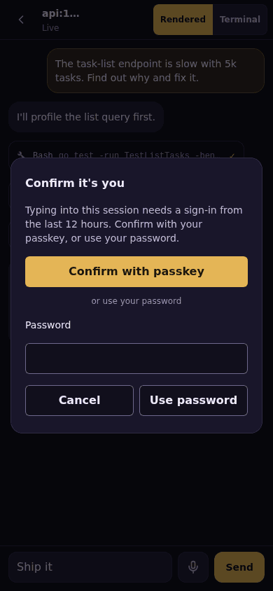

# The message box and step-up

## Where the message box appears

| view | message goes to | needs |
|---|---|---|
| A mirrored window's **Rendered** view (Claude Code) | the Claude Code pane, pasted as typed | the host's `-interactive`, plus a fresh sign-in |
| A mirrored window's **Terminal** view (any program) | the window's active pane, followed by Enter | the host's `-interactive`, plus a fresh sign-in |
| A dispatched agent's chat and **Terminal** view | `POST /agents/<name>/send`: one agent turn, run in the background | a running agent with chat wired ([provisioner.md](provisioner.md)) |
| The chief panel | the chief agent | as above |

Each box can also have a microphone; see [dictation.md](dictation.md).

**Mirrored sends:**

- A message is pasted into a *pane id*, never by switching windows.
- On the Rendered view, it goes only into a pane that is **still** running Claude
  Code, never into a shell left behind after Claude exits. A leading `/` or `!`
  is passed through as typed.
- On the Terminal view, the box does not need the Interactive switch. That switch
  is a live keyboard; the box is one gated paste per Send.
- Only newline and tab are accepted as control characters. Several lines arrive
  as one bracketed paste, and the single Enter runs them in order. A program that
  did not ask for bracketed paste gets the text as typed, so each newline is an
  Enter.
- On a read-only host the box is drawn disabled and says why. An offline host
  has no box.
- A non-Claude pane needs a `muster-mirror` that announces it can paste into any
  pane. With an older one, the box works only for Claude Code panes.

**Agent sends:**

- A message reaches only a running agent. Otherwise the box is disabled and says
  why.
- A failed turn is stored in the conversation, where the reply would have been.

## It works without JavaScript, and a message is delivered once

Every message box is a real `<form method="post">`.

- **With script**, it sends in place.
- **When script cannot help**, the browser submits the form itself. That
  happens if the script's request gets no answer while the browser is online
  (for example a sign-in redirect at an auth proxy, or a proxy error), or if
  script cannot run at all. muster answers with a redirect back to the same
  view, plus a line saying what happened: "Sent.", or the reason it was refused.
- **When the form path finds the sign-in stale**, it shows a plain confirm page
  that asks for the password (`POST /mirror/confirm-send`). That page carries the
  message and delivers it once you confirm.

Each message carries a one-time **nonce**. If a message is posted twice because
the first answer was lost, it is delivered once. Delivered nonces are remembered
in memory for 15 minutes, up to 4096 of them, keyed by owner, nonce and text. A
server restart forgets them.

Pages that carry such a form are served with `Referrer-Policy: same-origin` and
`Cache-Control: no-store`. The rest of the app uses `no-referrer`. Under that
policy, a browser sends `Origin: null` with a form it submits itself, and the
same-origin check refuses `Origin: null`.

## Step-up: "Confirm it's you"

Typing into a mirrored session needs a **fresh sign-in**: one within the step-up
window. This covers both an interactive terminal attach and every mirrored send.
A stale request is refused with 403 before the socket upgrades or anything is
pasted, and the mirror plugin checks again on its own.

Dispatched agents' terminals and sends are **not** step-up gated. Watching
read-only never is.

- **The window** is `MUSTER_STEPUP_WINDOW`, a Go duration. The default is `12h`.
  The server refuses to start with a value outside `1m`–`24h`.
- **What "signed in" means.**
  - In gotrue mode it is the time of the sign-in itself: the access token's `amr`
    timestamp. A token refresh does not move it, and a token with no `amr` is
    never fresh.
  - In password mode it is the session cookie's issue time.
- 🔴 **Freshness belongs to one browser session, never to the user.** It is read
  from the session each request presents, and nothing is recorded per user.
  Confirming on one device leaves your other devices as stale as they were.

When a send or attach is refused as stale, the page shows "Confirm it's you" and
then completes what was waiting: the attach, or sending the **same** text. Nothing
you typed is lost while the dialog is open. You can confirm in two ways:

- **With a passkey.** This is the default when the account has a passkey and the
  browser supports WebAuthn (gotrue mode only). The assertion must include user
  verification and must belong to the *signed-in* user, or it is refused. The
  passkey challenge is requested when the dialog opens, never on page load, and
  not at all for an account with no passkey. Routes:
  `POST /auth/confirm/passkey/options`, then `POST /auth/confirm/passkey/verify`.
- **With the password again** (`POST /auth/confirm`). In password mode this is
  `MUSTER_UI_PASSWORD`.

Both are same-origin only and throttled like sign-in.

The Interactive choice is remembered per host for the browser session. Adding a
passkey has its own fixed window of five minutes, separate from the step-up
window, because a new credential outlives the session that creates it.

