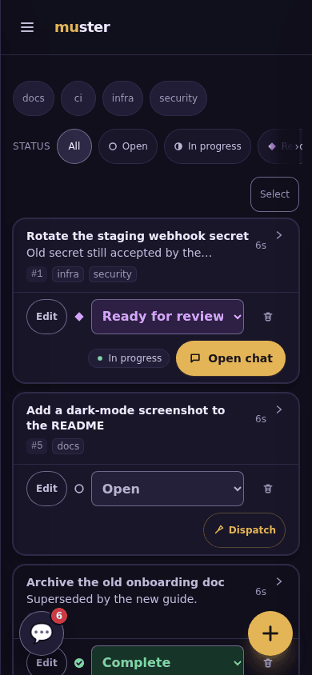

# The task board

Tasks are the shared work queue. People write them in the browser; agents and
scripts write them through the JSON API and the [CLI](cli.md).

## Tasks

- **Statuses:** `open`, `in_progress`, `ready_for_review`, `complete`. Every
  change is logged, with a warning when a status moves backwards. A dispatched
  agent cannot mark a task `complete` through its own route; people and the
  machine API can.
- **Comments:** comments can be added from the browser, the machine API
  (`POST /api/tasks/{id}/comments`), or an agent's own route
  (`POST /agent/task/comment`). A deleted comment leaves a tombstone.
- **Attachments:** up to 10 MiB each, stored in Postgres.
- **Tags:** up to 20 per task. Four namespaces route work:
  - `project:` — at most one per task;
  - `initiative:`;
  - `gate:` — blocks dispatch with 409;
  - `auto:`.
- **The review queue:** `ready_for_review` tasks are counted on the app badge.
  When push is on, they also notify ([push.md](push.md)).
- **Mark complete from the agent:** a dispatched agent's page shows a banner
  when its task is `ready_for_review`, with **Mark complete**. Completing it
  takes you back to the Agents list. Without JavaScript the button is a plain
  form (`POST /tasks/{id}/complete`) that completes the task and redirects to
  the Agents list too.
- **Completing stops the chief's agent:** when a task becomes `complete`, by
  any path, the agent the chief's `task_dispatch` started on it is **stopped**
  (not destroyed; Start brings it back), cutting off a turn it is running. An
  agent you started yourself is left running, and `ready_for_review` stops
  nothing. See [plugins.md](plugins.md) (the `task_dispatch` guards).
- **The idle reaper:** a task idle longer than `MUSTER_TASK_REAP_AFTER` (default
  7 days) is tagged `stale`, with a system comment. The sweep runs every 30
  minutes.
- **Retention:** a daily pass prunes connector audit rows and chat messages older
  than 90 days.

The task table is called `notes` for historical reasons (see
[schema.md](schema.md)).

## Provenance

Task writes from the CLI carry headers recording where they came from:

- `X-Muster-Source`;
- `X-Muster-Host`, the hostname;
- `X-Muster-Session-Id`, taken from `CLAUDE_CODE_SESSION_ID` or
  `CLAUDE_SESSION_ID` when the CLI runs inside an agent session.

A task records the session that created it. When a permission router is
configured, that session links to its transcript.

## GitHub

**With a GitHub App configured** ([github-app.md](github-app.md)), the App is
muster's GitHub identity. The Repos tab lists its installation's repositories,
and those are the "connected" repositories for every dispatch check. The OAuth
connection below is then not used.

**Without one (deprecated):** the Repos tab connects one GitHub account per user. It needs
`MUSTER_GITHUB_ENCRYPTION_KEY`, because tokens are stored encrypted. You can
connect an account in either of two ways:

- `MUSTER_GITHUB_TOKEN` connects that token at boot.
- `GITHUB_CLIENT_ID` and `GITHUB_CLIENT_SECRET` enable the
  `/github/connect` OAuth flow. Its callback is built from `MUSTER_PUBLIC_URL`.
